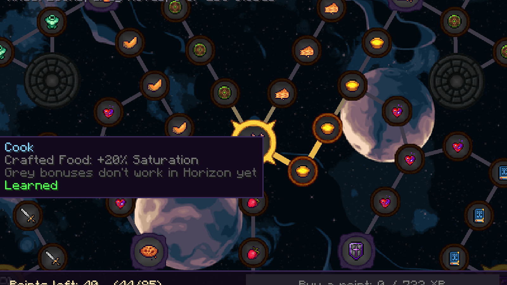

# Kotost Skill Tree

A native mod for [Horizon](https://playhorizon.dev) (Minecraft: Java Edition 26.3 rewritten in Rust): a big passive
skill tree. Spend experience on skill points, learn skills next to the ones you have, grow stronger your own way.

This is a port of **[Passive Skill Tree](https://www.curseforge.com/minecraft/mc-mods/passive-skill-tree) 0.6.14a by
Daripher** (GPL-3.0). The tree, its texts and pictures are the original's data files, baked by `tools/bake.py`; the code
is written anew for Horizon.

- **588 skills** on one starry map: warriors, archers, miners, cooks, mages, travellers, each with its own branches
  and big keystones.
- **Points for experience.** The button at the bottom buys a point for your levels; every next point costs more.
- **Up to three branches.** Pick up to three of the six starting skills; after that a skill can be learned when it
  touches one you already have. Hover a skill to read what it gives.
- **Saved on the server**, per player; the bonuses come back after death and on joining.

<table>
  <tr>
    <td width="50%"></td>
    <td width="50%"></td>
  </tr>
</table>

## Controls

- **O** or `/skilltree`: open the tree. Mouse wheel zooms, hold the left button to move, click a skill to learn it.
- Operators: `/skilltree points <n>` gives points, `/skilltree reset` forgets the learned skills and returns the points.

Russian and English, by the game's language.

## What works in 0.1.0

Attributes (armor, health, attack speed, damage, speed, luck, toughness), melee, projectile and magic damage,
critical chance and damage, evasion, blocking (with a shield), mining speed, jump height, experience per minute;
conditions "holding / wearing" and "health percent". That is 238 of the tree's 649 bonuses.

The rest is drawn **grey** in the tooltips and does nothing yet: crafted item bonuses, gems and sockets, quivers,
enchanting, potions, food, healing and regeneration, stealth, double loot, experience by source, conditions on
effects and hunger. They come in later versions.

Differences from the original: up to three starting skills instead of two, cheaper points (10 to 300 experience
points, all 85 for about 13,000), a click learns a skill at once (no "Confirm"), there is no amnesia scroll (an
operator resets with `/skilltree reset`).

## Install

You need the Horizon launcher from [playhorizon.dev](https://playhorizon.dev) and a Microsoft account that owns
Minecraft: Java Edition.

1. Open the launcher, go to **Mods** and press **Add from GitHub**.
2. Paste `https://github.com/Leks2000/kotost-skilltree` and confirm.
   The launcher warns that native mods are not reviewed by the Horizon registry and run with full access to your
   computer. That is true of every native mod: read the source first (`skilltree.rs` and `hooks/`).
3. The launcher builds the game with the mod. The first build takes a while (20-40 minutes on an average PC).
4. Press Play.

Command line: `horizon-launcher mods add-github https://github.com/Leks2000/kotost-skilltree --trust-native-code`

The mod is needed **on the server and on the client** (in single player both are your game).

## Server settings: `config/kotost_skilltree.txt`

| Key | Default | What it does |
| --- | --- | --- |
| `max_points` | `85` | How many points a player can buy. |
| `first_cost` | `10` | Experience points for the first point. |
| `last_cost` | `300` | Experience points for the last one; the points between cost more step by step. |

Learned skills are kept in `config/kotost_skilltree_players.txt`.

## License

GPL-3.0-or-later, like the original (`LICENSE`). Passive Skill Tree © Daripher. Port © 2026 Kotost Games.
