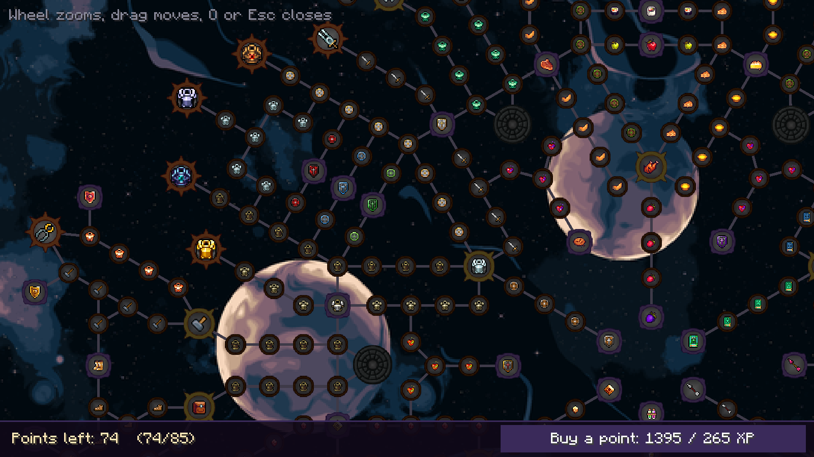
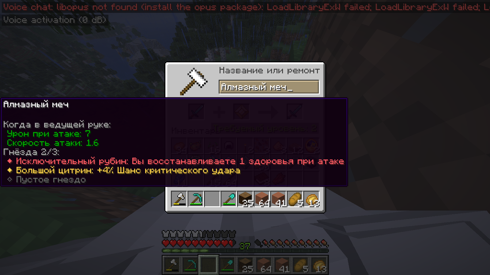
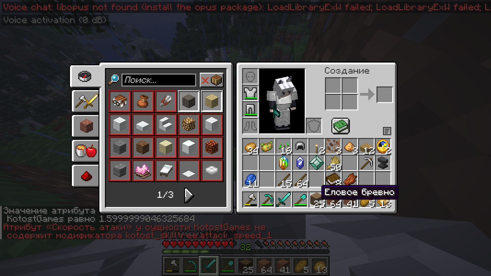
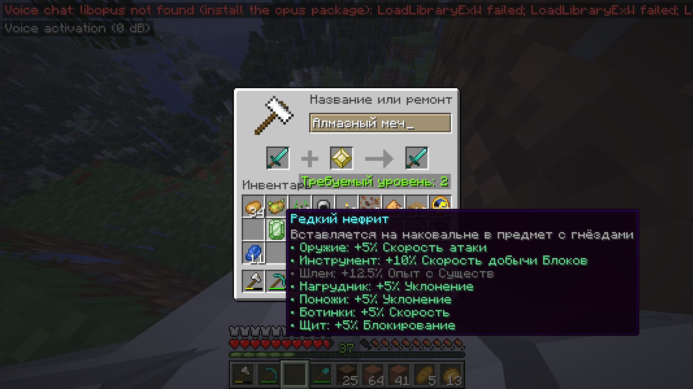

# Kotost Skill Tree

A native mod for [Horizon](https://playhorizon.dev) (Minecraft: Java Edition 26.3 rewritten in Rust): a big passive
skill tree. Spend experience on skill points, learn skills next to the ones you have, grow stronger your own way.

This is a port of **[Passive Skill Tree](https://www.curseforge.com/minecraft/mc-mods/passive-skill-tree) 0.6.14a by
Daripher** (GPL-3.0). The tree, its texts and pictures are the original's data files, baked by `tools/bake.py`; the code
is written anew for Horizon.

- **588 skills** on one starry map: warriors, archers, miners, cooks, mages, travellers, each with its own branches
  and big keystones.
- **Points for experience.** The button at the bottom buys a point for your levels; every next point costs more.
- **Up to three branches.** Pick up to three of the six starting skills; after that a skill can be learned when it
  touches one you already have. Hover a skill to read what it gives.
- **Saved on the server**, per player; the bonuses come back after death and on joining.

<table>
  <tr>
    <td width="50%"></td>
    <td width="50%"></td>
  </tr>
</table>

## Gems and sockets (0.2.0)

Mining ores sometimes gives a **gem**: citrine, iriscite, jade, ruby or sapphire, in six tiers from "crumbled" to
"exceptional", and a rare **vacucite**. The more valuable the ore, the higher the chance and the tier: coal gives
crumbled gems once in a hundred, diamond gives good ones once in ten. Nothing drops with Silk Touch.

- **Sockets.** Pickaxes, axes, shovels, swords, bows, crossbows, tridents, maces, shields and armour have 1 to 3
  sockets by material: wood, stone, gold and leather 1; iron, copper, bows, crossbows and shields 2; diamond,
  netherite, tridents and maces 3.
- **Anvil.** Put the item on the left and a gem on the right: the gem goes into the next free socket for 1-3 levels.
  A vacucite empties all the sockets; an iriscite rolls one of its bonuses.
- **Bonuses** depend on the gem and on the item: a ruby in armour gives health, a jade in a sword gives attack
  speed, a sapphire in a pickaxe gives mining efficiency, and so on. They work while the item is held or worn.
- **Tooltips.** An item shows "Sockets 2/3" with its gems in their colours; a gem shows its bonus for each kind of
  item (grey: not working yet).
- **Tree skills about gems** now work: gem power, extra sockets, "if the item has gems", "for each gem".

<table>
  <tr>
    <td width="33%"></td>
    <td width="33%"></td>
    <td width="33%"></td>
  </tr>
</table>

The gems are items of a separate content mod, **Kotost Gems** (`kotost_gems`, folder `content/` here, the
`kotost_gems-0.2.0.hmod` file in `catalog/`). Install it next to the skill tree on the server and the client; the
drops, sockets and bonuses are this native mod's.

`/skilltree gems` tells you what your worn items have in their sockets and which bonuses you get.

## Controls

- **O** or `/skilltree`: open the tree. Mouse wheel zooms, hold the left button to move, click a skill to learn it.
- Operators: `/skilltree points <n>` gives points, `/skilltree reset` forgets the learned skills and returns the points.

Russian and English, by the game's language.

## What works

Attributes (armor, health, attack speed, damage, speed, luck, toughness), melee, projectile and magic damage,
critical chance and damage, evasion, blocking (with a shield), mining speed, jump height, experience per minute;
conditions "holding / wearing" and "health percent"; in 0.2.0 also gems, sockets, conditions on gems and healing on
hit. That is 291 of the tree's 649 bonuses.

The rest is drawn **grey** in the tooltips and does nothing yet: crafted item bonuses, jewellery, quivers,
enchanting, potions, food, healing and regeneration, stealth, double loot, experience by source, conditions on
effects and hunger. They come in later versions.

Differences from the original: up to three starting skills instead of two, cheaper points (10 to 300 experience
points, all 85 for about 13,000), a click learns a skill at once (no "Confirm"), there is no amnesia scroll (an
operator resets with `/skilltree reset`).

## Install

You need the Horizon launcher from [playhorizon.dev](https://playhorizon.dev) and a Microsoft account that owns
Minecraft: Java Edition.

1. Open the launcher, go to **Mods** and press **Add from GitHub**.
2. Paste `https://github.com/Leks2000/kotost-skilltree` and confirm.
   The launcher warns that native mods are not reviewed by the Horizon registry and run with full access to your
   computer. That is true of every native mod: read the source first (`skilltree.rs` and `hooks/`).
3. The launcher builds the game with the mod. The first build takes a while (20-40 minutes on an average PC).
4. For the gems, also install **Kotost Gems** (`kotost_gems`) from the mod catalog: **Mods**, search "Kotost Gems".
5. Press Play.

Command line: `horizon-launcher mods add-github https://github.com/Leks2000/kotost-skilltree --trust-native-code`

The mod is needed **on the server and on the client** (in single player both are your game).

## Server settings: `config/kotost_skilltree.txt`

| Key | Default | What it does |
| --- | --- | --- |
| `max_points` | `85` | How many points a player can buy. |
| `first_cost` | `10` | Experience points for the first point. |
| `last_cost` | `300` | Experience points for the last one; the points between cost more step by step. |
| `gem_<ore>` | see below | `chance lowest_tier highest_tier` for an ore (coal, copper, iron, gold, redstone, lapis, emerald, diamond; deepslate ores count as theirs). Tiers 0-5. No rebuild needed. |
| `gem_vacucite` | `0.004` | The chance of a vacucite from emerald and diamond ores. |

Ore defaults: coal `0.01 0 1`, copper `0.012 0 1`, iron `0.02 0 2`, gold `0.03 1 2`, redstone `0.03 1 3`,
lapis `0.035 1 3`, emerald `0.08 2 4`, diamond `0.1 2 5`.

Learned skills are kept in `config/kotost_skilltree_players.txt`.

## License

GPL-3.0-or-later, like the original (`LICENSE`). Passive Skill Tree © Daripher. Port © 2026 Kotost Games.
